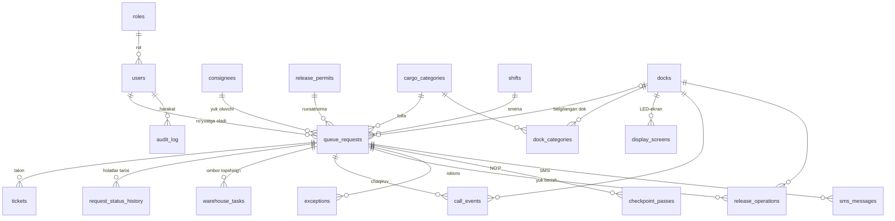
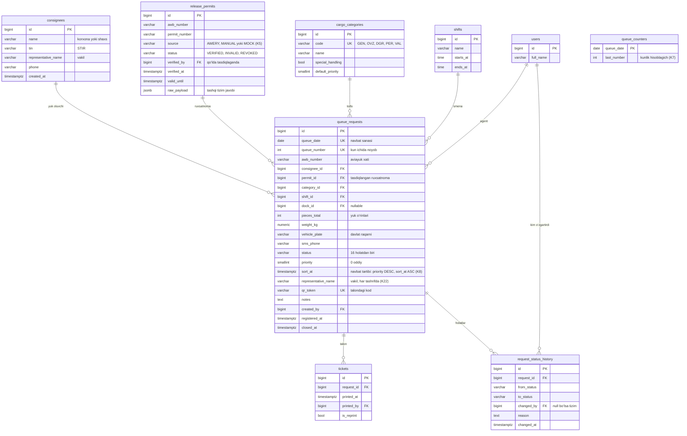
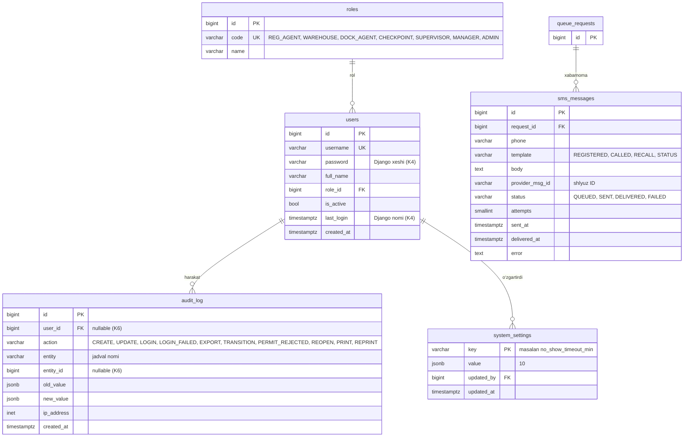

# Ma’lumotlar bazasi modeli (ER)

PostgreSQL 16. Jadval va ustun nomlari — kodda shu nomlar ishlatiladi. Bu model boshlang‘ich taklif: kod yozish jarayonida asosli o‘zgartirish mumkin, lekin har bir o‘zgarish shu faylda ham yangilanishi kerak.

## Umumiy ko‘rinish

## 1. Ariza va ro‘yxatga olish

## 2. Ombor, dok va NO‘P

```mermaid
erDiagram
  queue_requests ||--o{ warehouse_tasks : "topshiriq"
  queue_requests ||--o{ call_events : "chaqiruv"
  queue_requests ||--o{ release_operations : "yuk berish"
  queue_requests ||--o{ exceptions : "istisno"
  queue_requests ||--o{ checkpoint_passes : "NO‘P"
  docks ||--o{ call_events : ""
  docks ||--o{ release_operations : ""
  docks ||--o{ display_screens : "ekran"
  docks ||--o{ dock_categories : ""
  cargo_categories ||--o{ dock_categories : "ruxsat etilgan"

  queue_requests {
    bigint id PK
    int queue_number
    varchar status
  }
  warehouse_tasks {
    bigint id PK
    bigint request_id FK
    bigint assigned_to FK "ombor xodimi"
    varchar storage_location "ombordagi joyi"
    varchar status "NEW, IN_PROGRESS, READY, HANDED_OVER, PROBLEM"
    timestamptz created_at
    timestamptz started_at
    timestamptz ready_at
    timestamptz handed_over_at "dokka topshirildi"
  }
  docks {
    bigint id PK
    varchar code UK "D-01"
    varchar name
    varchar state "FREE, BUSY, MAINTENANCE"
    bool is_active
    bigint current_agent_id FK "nullable, dokdagi agent (K27)"
    timestamptz agent_ready_at "xodim tayyor (K27)"
  }
  dock_categories {
    bigint id PK "surrogate; UNIQUE(dock_id, category_id)"
    bigint dock_id FK
    bigint category_id FK
  }
  cargo_categories {
    bigint id PK
    varchar code
  }
  display_screens {
    bigint id PK
    bigint dock_id FK "null bo‘lsa umumiy ekran"
    varchar kind "DOCK_LED yoki HALL"
    varchar address "IP yoki port"
    varchar protocol "BROWSER, TCP, RS485"
    timestamptz last_seen_at
  }
  call_events {
    bigint id PK
    bigint request_id FK
    bigint dock_id FK
    smallint attempt_no "1 birinchi, 2+ takroriy"
    bigint called_by FK
    timestamptz called_at
    timestamptz arrived_at "mijoz keldi"
    varchar outcome "ARRIVED, NO_SHOW, PENDING"
  }
  release_operations {
    bigint id PK
    bigint request_id FK
    bigint dock_id FK
    bigint agent_id FK
    timestamptz started_at
    timestamptz finished_at
    int pieces_released "berilgan o‘rinlar"
    numeric weight_released_kg
  }
  exceptions {
    bigint id PK
    bigint request_id FK
    varchar kind "MISSING, DAMAGE, SHORTAGE, MISMATCH, PARTIAL, NO_SHOW, CHECKPOINT (jadval nomi: exceptions, model: ExceptionRecord)"
    int pieces_affected
    text description
    bigint reported_by FK
    timestamptz reported_at
    bigint resolved_by FK
    timestamptz resolved_at
    text resolution "qaror"
  }
  checkpoint_passes {
    bigint id PK
    bigint request_id FK
    bigint officer_id FK "NO‘P xodimi"
    timestamptz scanned_at
    varchar plate_observed "haqiqiy raqam"
    varchar result "APPROVED yoki HELD"
    timestamptz exit_confirmed_at
  }
```

## 3. Foydalanuvchilar, SMS va audit

